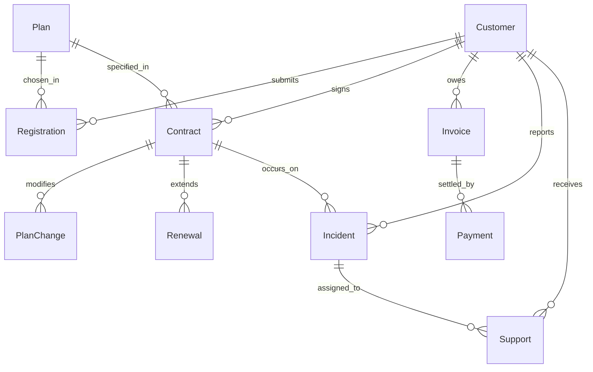

# FTTH Subscriber & Service Management System

A high-performance, console-based Business Support System (BSS) and Operations Support System (OSS) designed for Fiber-To-The-Home (FTTH) telecommunications service providers. Implemented in modern C++ (C++17 standard) utilizing Object-Oriented Programming (OOP) and generic architectural patterns.

---

## 1. System Overview & Architecture

The FTTH Management System automates the complete subscriber service lifecycle—ranging from customer onboarding, service provisioning, and subscription tier management to contractual renewals, billing reconciliations, and technical incident ticketing.

### Architectural Principles

The application adopts a **layered architectural style** with strict separation of concerns:

- **Presentation Layer (`src/Application.cpp`, `include/Menus.h`)**: Implements dynamic console menus, handles user navigation flows, and orchestrates transaction execution across the 10 business use cases.
- **Application / Use Case Layer (`src/use_cases/UC*.cpp`)**: Encapsulates discrete domain operations for each specific functional module (UC1 through UC10).
- **Domain Entity Layer (`include/Entities.h`)**: Provides an abstract base class `Entity` and concrete model representations for all 10 domain entities. Defines contracts for field validation, console table rendering (`displayRow`), and pipe-delimited serialization (`toFileString`, `fromFileString`).
- **Data Access & Persistence Layer (`include/Repository.h`, `include/AppData.h`)**: Implements a generic template-based repository pattern (`Repository<T>`). Provides in-memory caching, unique primary key constraint enforcement, defensive data parsing, and file-backed persistence.
- **Cross-Cutting Utilities (`include/InputHelper.h`, `include/Validator.h`)**: Supplies defensive input sanitization, regular expression validations, safe numeric parsing, and formatted console layouts.

```text
┌─────────────────────────────────────────────────────────────┐
│                     Presentation Layer                      │
│            main.cpp  ──>  Application.cpp (Menus)           │
└──────────────────────────────┬──────────────────────────────┘
                               │ Dispatches
                               ▼
┌─────────────────────────────────────────────────────────────┐
│                    Application / UC Layer                   │
│           UC1_Customers.cpp ... UC10_Supports.cpp           │
└──────────────────────────────┬──────────────────────────────┘
                               │ Manipulates
                               ▼
┌──────────────────────────────┬──────────────────────────────┐
│         Domain Layer         │      Persistence Layer       │
│          Entities.h          │   Repository.h / AppData.h   │
│   (Abstract Entity + 10 DTOs)│   (In-memory + File Storage) │
└──────────────────────────────┴──────────────┬───────────────┘
                                              │ I/O
                                              ▼
                               ┌──────────────────────────────┐
                               │   Flat-File Storage Layer    │
                               │          data/*.txt          │
                               └──────────────────────────────┘
```

---

## 2. Codebase Organization

```text
btl-ktlt2/
├── bin/                          # Directory for compiled binary executables
├── data/                         # Persistent flat-file storage (Pipe-delimited records)
│   ├── contracts.txt             # Service contracts
│   ├── customers.txt             # Subscriber registry
│   ├── incidents.txt             # Service incident reports
│   ├── invoices.txt              # Monthly billing statements
│   ├── payments.txt              # Payment receipts and transactions
│   ├── plan_changes.txt          # Subscription modification logs
│   ├── plans.txt                 # Internet tariff packages catalog
│   ├── registrations.txt         # Initial service order requests
│   ├── renewals.txt              # Contract renewal extensions
│   └── supports.txt              # Technical assistance tickets
├── include/                      # C++ Header files (Interfaces, Templates, Declarations)
│   ├── AppData.h                 # Aggregated application state and repository container
│   ├── Entities.h                # Abstract Entity base class and 10 domain entity models
│   ├── InputHelper.h             # Safe terminal I/O, prompt validation, and record tokenizers
│   ├── Menus.h                   # Menu routing declarations and shared helper signatures
│   ├── Repository.h              # Generic template repository with auto-persistence
│   └── Validator.h               # String, date (YYYY-MM-DD), and numeric validators
├── src/                          # C++ Source files
│   ├── main.cpp                  # Program entry point (exception boundary)
│   ├── Application.cpp           # Main dashboard loop and router for UC1-UC10
│   └── use_cases/                # Modular implementations of business use cases
│       ├── UC1_Customers.cpp     # Customer profile management
│       ├── UC2_Registrations.cpp # New service intake & provisioning
│       ├── UC3_Plans.cpp         # Tariff catalog maintenance
│       ├── UC4_PlanChanges.cpp   # Subscription upgrades & bandwidth migrations
│       ├── UC5_Contracts.cpp     # Master service contract administration
│       ├── UC6_Renewals.cpp      # Subscription term extension
│       ├── UC7_Payments.cpp      # Payment collection & ledger reconciliation
│       ├── UC8_Invoices.cpp      # Billing statement generation & status tracking
│       ├── UC9_Incidents.cpp     # Network fault logging & diagnostics
│       └── UC10_Supports.cpp     # Technician dispatch & service ticket resolution
├── CMakeLists.txt                # Cross-platform CMake 3.10+ build configuration
├── Makefile                      # Standard GNU Make automated build script
├── .gitignore                    # Artifact exclusions (binaries, objects, IDE cache)
└── README.md                     # Comprehensive technical documentation
```

---

## 3. Functional Specifications (Use Cases)

| Identifier | Module Name | Primary Entity | Core Capabilities |
| :--- | :--- | :--- | :--- |
| **UC1** | Customer Management | `Customer` | Register subscribers, edit demographics, search by ID/Name/Phone/National ID, list active clients. |
| **UC2** | Service Registration | `Registration` | Process initial FTTH service orders, validate plan suitability, track deployment statuses (`Cho lap dat`, `Da lap dat`). |
| **UC3** | Tariff Plan Catalog | `Plan` | Maintain internet packages, configure bandwidth tiers (e.g., 100-1000 Mbps), pricing, and validity cycles. |
| **UC4** | Plan Migration | `PlanChange` | Execute plan upgrades/downgrades on active contracts, log historical transitions, verify contract eligibility. |
| **UC5** | Contract Administration | `Contract` | Issue binding service agreements, validate customer and package foreign keys, manage lifecycle states (`Dang hoat dong`, `Tam ngung`, `Da cham dut`). |
| **UC6** | Service Renewals | `Renewal` | Extend contract validity periods by specified months, automatically recalculate new termination dates, verify active status. |
| **UC7** | Payment Processing | `Payment` | Record transactional payments against invoices, update accounts receivable, automatically synchronize invoice status upon full settlement. |
| **UC8** | Billing & Invoicing | `Invoice` | Generate periodic service invoices, monitor settlement statuses (`Chua thanh toan`, `Da thanh toan`). |
| **UC9** | Incident Management | `Incident` | Log technical service disruptions linked to specific contracts, track resolution workflows (`Moi tiep nhan`, `Dang xu ly`, `Da khac phuc`). |
| **UC10** | Technical Support | `Support` | Dispatch field engineers, record maintenance notes, track remediation progress and ticket lifecycle. |

---

## 4. Entity-Relationship Model & Data Dictionary

All system data is persistently stored in `data/*.txt` utilizing a pipe-delimited (`|`) UTF-8 ASCII format. Empty lines and comment lines prefixed with `#` are automatically ignored during repository loading.

### Entity-Relationship Diagram



---

### Detailed Schema Specifications

#### 1. Customers (`data/customers.txt`)
- **Primary Key**: `customerId` (Format: `KHxxx`)
- **Format**: `customerId|fullName|phone|cccd|address|contact`

| Field | Type | Constraint | Description |
| :--- | :--- | :--- | :--- |
| `customerId` | `string` | PK, Non-empty, Unique | Unique subscriber identifier |
| `fullName` | `string` | Non-empty | Customer full legal name |
| `phone` | `string` | Numeric, Non-empty | Primary contact telephone number |
| `cccd` | `string` | Numeric, Non-empty | National Citizen Identity Card (CCCD) |
| `address` | `string` | Non-empty | Installation physical address |
| `contact` | `string` | Optional | Secondary contact (Email address / Alternate phone) |

*Sample Records:*
```text
KH001|Nguyen Van An|0912345001|001201000001|Cau Giay, Ha Noi|an.nguyen@example.com
KH002|Tran Thi Binh|0912345002|001201000002|Dong Da, Ha Noi|binh.tran@example.com
KH003|Le Minh Chau|0912345003|001201000003|Hai Ba Trung, Ha Noi|chau.le@example.com
```

---

#### 2. Tariff Plans (`data/plans.txt`)
- **Primary Key**: `planId` (Format: `GOIxxx`)
- **Format**: `planId|name|speed|price|duration`

| Field | Type | Constraint | Description |
| :--- | :--- | :--- | :--- |
| `planId` | `string` | PK, Non-empty, Unique | Tariff package code |
| `name` | `string` | Non-empty | Marketing title of the subscription |
| `speed` | `string` | Non-empty | Guaranteed bandwidth rate (e.g., `100 Mbps`) |
| `price` | `string` | Numeric string (> 0) | Recurring subscription fee (VND) |
| `duration` | `string` | Non-empty | Billing interval / validity cycle (e.g., `30 ngay`) |

*Sample Records:*
```text
GOI001|FTTH Co ban|100 Mbps|180000|30 ngay
GOI002|FTTH Tieu chuan|200 Mbps|230000|30 ngay
GOI003|FTTH Gia dinh|300 Mbps|280000|30 ngay
```

---

#### 3. Service Registrations (`data/registrations.txt`)
- **Primary Key**: `registrationId` (Format: `DKxxx`)
- **Format**: `registrationId|customerId|planId|regDate|status`

| Field | Type | Constraint | Description |
| :--- | :--- | :--- | :--- |
| `registrationId`| `string` | PK, Non-empty, Unique | Service order tracking code |
| `customerId` | `string` | FK -> `Customer.customerId` | Registered subscriber code |
| `planId` | `string` | FK -> `Plan.planId` | Selected tariff package code |
| `regDate` | `string` | Date format `YYYY-MM-DD` | Timestamp of subscription intake |
| `status` | `string` | Non-empty | Fulfillment stage (`Cho lap dat`, `Da lap dat`) |

*Sample Records:*
```text
DK001|KH001|GOI001|2026-01-01|Da lap dat
DK002|KH002|GOI002|2026-01-02|Da lap dat
DK003|KH003|GOI003|2026-01-03|Da lap dat
```

---

#### 4. Service Contracts (`data/contracts.txt`)
- **Primary Key**: `contractId` (Format: `HDxxx`)
- **Format**: `contractId|customerId|planId|startDate|endDate|status`

| Field | Type | Constraint | Description |
| :--- | :--- | :--- | :--- |
| `contractId` | `string` | PK, Non-empty, Unique | Legal agreement number |
| `customerId` | `string` | FK -> `Customer.customerId` | Contracting party identifier |
| `planId` | `string` | FK -> `Plan.planId` | Subscribed package identifier |
| `startDate` | `string` | Date format `YYYY-MM-DD` | Effective activation date |
| `endDate` | `string` | Date format `YYYY-MM-DD` | Expiration / renewal due date |
| `status` | `string` | Non-empty | Contract operational state (`Dang hoat dong`, `Tam ngung`) |

*Sample Records:*
```text
HD001|KH001|GOI001|2026-01-01|2027-01-01|Dang hoat dong
HD002|KH002|GOI002|2026-01-02|2027-01-02|Dang hoat dong
HD003|KH003|GOI003|2026-01-03|2027-01-03|Dang hoat dong
```

---

#### 5. Plan Modifications (`data/plan_changes.txt`)
- **Primary Key**: `planChangeId` (Format: `DCxxx`)
- **Format**: `planChangeId|contractId|oldPlanId|newPlanId|date|status`

| Field | Type | Constraint | Description |
| :--- | :--- | :--- | :--- |
| `planChangeId` | `string` | PK, Non-empty, Unique | Change request tracking ID |
| `contractId` | `string` | FK -> `Contract.contractId` | Target contract being adjusted |
| `oldPlanId` | `string` | FK -> `Plan.planId` | Preceding package tier |
| `newPlanId` | `string` | FK -> `Plan.planId` | Successor package tier |
| `date` | `string` | Date format `YYYY-MM-DD` | Effective execution date |
| `status` | `string` | Non-empty | Operational state (`Da thuc hien`) |

*Sample Records:*
```text
DC001|HD001|GOI001|GOI002|2026-03-01|Da thuc hien
DC002|HD002|GOI002|GOI003|2026-03-02|Da thuc hien
DC003|HD003|GOI003|GOI004|2026-03-03|Da thuc hien
```

---

#### 6. Contract Renewals (`data/renewals.txt`)
- **Primary Key**: `renewalId` (Format: `GHxxx`)
- **Format**: `renewalId|contractId|oldEnd|newEnd|months|status`

| Field | Type | Constraint | Description |
| :--- | :--- | :--- | :--- |
| `renewalId` | `string` | PK, Non-empty, Unique | Extension transaction ID |
| `contractId` | `string` | FK -> `Contract.contractId` | Target agreement extended |
| `oldEnd` | `string` | Date format `YYYY-MM-DD` | Prior maturity date |
| `newEnd` | `string` | Date format `YYYY-MM-DD` | Updated maturity date post-extension |
| `months` | `integer` | Positive integer (> 0) | Duration added in months |
| `status` | `string` | Non-empty | Transaction outcome (`Thanh cong`) |

*Sample Records:*
```text
GH001|HD001|2027-01-01|2027-04-01|3|Thanh cong
GH002|HD002|2027-01-02|2027-04-02|3|Thanh cong
GH003|HD003|2027-01-03|2027-04-03|3|Thanh cong
```

---

#### 7. Billing Invoices (`data/invoices.txt`)
- **Primary Key**: `invoiceId` (Format: `HDONxxx`)
- **Format**: `invoiceId|customerId|amount|status`

| Field | Type | Constraint | Description |
| :--- | :--- | :--- | :--- |
| `invoiceId` | `string` | PK, Non-empty, Unique | Invoice billing statement ID |
| `customerId` | `string` | FK -> `Customer.customerId` | Billed party |
| `amount` | `string` | Numeric string (> 0) | Total payable balance (VND) |
| `status` | `string` | Non-empty | Payment status (`Chua thanh toan`, `Da thanh toan`) |

*Sample Records:*
```text
HDON001|KH001|180000|Chua thanh toan
HDON002|KH002|230000|Chua thanh toan
HDON003|KH003|280000|Chua thanh toan
```

---

#### 8. Payments (`data/payments.txt`)
- **Primary Key**: `paymentId` (Format: `TTxxx`)
- **Format**: `paymentId|invoiceId|amount|status`

| Field | Type | Constraint | Description |
| :--- | :--- | :--- | :--- |
| `paymentId` | `string` | PK, Non-empty, Unique | Payment transaction receipt ID |
| `invoiceId` | `string` | FK -> `Invoice.invoiceId` | Target settled invoice |
| `amount` | `string` | Numeric string (> 0) | Settled funds (VND) |
| `status` | `string` | Non-empty | Transaction outcome (`Thanh cong`) |

*Sample Records:*
```text
TT001|HDON001|180000|Thanh cong
TT002|HDON002|230000|Thanh cong
TT003|HDON003|280000|Thanh cong
```

---

#### 9. Service Incidents (`data/incidents.txt`)
- **Primary Key**: `incidentId` (Format: `SCxxx`)
- **Format**: `incidentId|contractId|customerId|description|status`

| Field | Type | Constraint | Description |
| :--- | :--- | :--- | :--- |
| `incidentId` | `string` | PK, Non-empty, Unique | Trouble ticket identification code |
| `contractId` | `string` | FK -> `Contract.contractId` | Affected service circuit/agreement |
| `customerId` | `string` | FK -> `Customer.customerId` | Reporting party identifier |
| `description` | `string` | Non-empty | Problem description and observed symptoms |
| `status` | `string` | Non-empty | Lifecycle state (`Moi tiep nhan`, `Dang xu ly`, `Da khac phuc`) |

*Sample Records:*
```text
SC001|HD001|KH001|Mat ket noi mang tai nha khach hang 1|Moi tiep nhan
SC002|HD002|KH002|Mat ket noi mang tai nha khach hang 2|Moi tiep nhan
SC003|HD003|KH003|Mat ket noi mang tai nha khach hang 3|Moi tiep nhan
```

---

#### 10. Technical Support Tickets (`data/supports.txt`)
- **Primary Key**: `supportId` (Format: `HTxxx`)
- **Format**: `supportId|customerId|incidentId|technician|note|history|status`

| Field | Type | Constraint | Description |
| :--- | :--- | :--- | :--- |
| `supportId` | `string` | PK, Non-empty, Unique | Field support assignment ID |
| `customerId` | `string` | FK -> `Customer.customerId` | Supported customer identifier |
| `incidentId` | `string` | FK -> `Incident.incidentId` | Linked incident ticket |
| `technician` | `string` | Non-empty | Assigned field technician name |
| `note` | `string` | Free text | Work order remarks and diagnosis |
| `history` | `string` | Free text | Remediation action log |
| `status` | `string` | Non-empty | Resolution stage (`Cho phan cong`, `Dang xu ly`, `Hoan thanh`) |

*Sample Records:*
```text
HT001|KH001|SC001|Ky thuat vien 1|Da tiep nhan yeu cau|Tiep nhan yeu cau|Cho phan cong
HT002|KH002|SC002|Ky thuat vien 2|Da tiep nhan yeu cau|Tiep nhan yeu cau|Cho phan cong
HT003|KH003|SC003|Ky thuat vien 3|Da tiep nhan yeu cau|Tiep nhan yeu cau|Cho phan cong
```

---

## 5. Build, Compilation & Execution

> [!IMPORTANT]
> The application resolves database files via relative paths (e.g. `data/customers.txt`). **Always execute the binary from the root directory of the repository**.

### Prerequisites
- Modern C++ compiler supporting **C++17** (`g++` >= 9.0, `clang++` >= 10.0, or MSVC >= 2019).
- Build system: GNU `make` or `cmake` (>= 3.10).

---

### Option A: Building with GNU Make (Recommended)

1. **Compile**:
   ```bash
   make
   ```
   *Compiles all source units with `-std=c++17 -Wall -Wextra -Iinclude` into `bin/main`.*

2. **Execute**:
   ```bash
   make run
   ```

3. **Clean Build Cache**:
   ```bash
   make clean
   ```

---

### Option B: Building with CMake

1. **Generate Build System**:
   ```bash
   cmake -B build
   ```

2. **Compile Target**:
   ```bash
   cmake --build build
   ```

3. **Run**:
   ```bash
   ./bin/ftth_app
   ```

---

### Option C: Direct GCC Compilation

Compile all translation units manually in one command:

```bash
# On Linux / macOS
g++ -std=c++17 -Wall -Wextra -Iinclude src/main.cpp src/Application.cpp src/use_cases/*.cpp -o bin/main
./bin/main

# On Windows (MinGW)
g++ -std=c++17 -Wall -Wextra -Iinclude src/main.cpp src/Application.cpp src/use_cases/*.cpp -o bin/main.exe
bin\main.exe
```

---

## 6. Technical Optimizations & Quality Assurance

1. **Automated Atomic Persistence**:
   - `Repository<T>::add()` and `Repository<T>::removeById()` automatically synchronize with the storage disk upon execution, eliminating repetitive manual `save()` calls.
   - Direct field mutations on cached entities invoke `save()` selectively only when modifications occur.
2. **Defensive Storage Bootstrapping**:
   - `Repository<T>::load()` automatically verifies and creates the target storage directory (`data/`) using standard `std::filesystem::create_directories`.
   - Missing data files are automatically initialized upon startup to avoid unhandled runtime faults.
3. **Robust Data Parsing**:
   - Malformed records or duplicated primary keys during deserialization are skipped with explanatory warnings rather than terminating execution.
4. **Translation Unit Isolation**:
   - Each use case (`UC1` through `UC10`) resides in its dedicated `.cpp` implementation file, promoting clean separation of concerns and maintainability.
